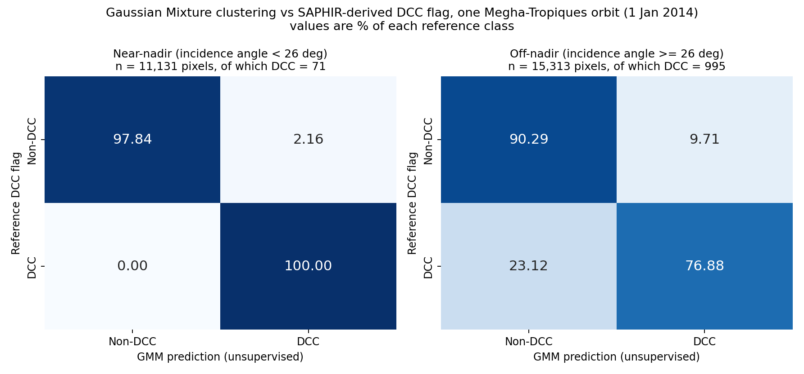

# Deep Convective Cloud Detection in Megha-Tropiques Data

This research prototype explores the detection of **deep convective clouds (DCCs)** in Megha-Tropiques satellite observations. It uses SAPHIR brightness temperatures to create a reference DCC flag, then evaluates whether an unsupervised Gaussian Mixture Model (GMM) can recover that flag.

The longer-term objective is to detect DCCs using ScaRaB visible and thermal-infrared observations. The current GMM experiment uses SAPHIR data; it does not yet demonstrate independent DCC detection from ScaRaB.

## Results

The figure compares the GMM predictions with the SAPHIR-derived reference flag for one orbit from **1 January 2014**. Separate two-component GMMs were fitted for near-nadir and off-nadir pixels using incidence angle, SAPHIR channels 1–5, and a land/ocean mask. The model fit is unsupervised; reference labels are used to evaluate and orient the otherwise arbitrary cluster labels.



| Incidence-angle band | Pixels | Reference DCC pixels | DCC recall | False-alarm rate |
|---|---:|---:|---:|---:|
| Near-nadir (< 26°) | 11,131 | 71 (0.64%) | 100.00% | 2.16% |
| Off-nadir (≥ 26°) | 15,313 | 995 (6.50%) | 76.88% | 9.71% |

The false-alarm rate is the percentage of reference non-DCC pixels predicted as DCC. The near-nadir recall is based on only 71 reference DCC pixels. Full-precision source values are available in [`results/tables/gmm_vs_flag.csv`](results/tables/gmm_vs_flag.csv).

### Robustness check

Removing TB1 from the GMM features gives near-nadir recall of **100.00%** and off-nadir recall of **72.06%**. This suggests that the other water-vapour channels also carry a cold-cloud signal.

### Interpretation and limitations

- The reference flag and GMM inputs are derived from the same SAPHIR observations. Agreement shows that the flag can be recovered without labels during fitting; it is **not** independent validation against radar, ScaRaB, or another instrument.
- Fitting and evaluation use the same pixels from a single orbit; there is no held-out orbit or month.
- Results are weaker at larger viewing angles, and the near-nadir DCC sample is small.
- Future work includes testing across held-out orbits and months, using ScaRaB visible/infrared measurements, and comparing against supervised classifiers.

## Reference DCC flag

[`src/grid_func.py`](src/grid_func.py) marks a pixel as DCC when SAPHIR channel-1 brightness temperature (TB1) is between 0 K and 230 K, inclusive. It assigns a DCC level (11–16) by comparing TB differences across channels against an incidence-angle-dependent threshold:

```text
TD = 0.04761 - 0.01678 × z + 0.00599 × z²
```

Here, `z` is the incidence angle in radians.

## Getting started

### Requirements

Python and the packages listed in [`requirements.txt`](requirements.txt) are required. Create and activate a virtual environment, then install the dependencies:

```bash
python -m venv .venv
```

On Windows PowerShell:

```powershell
.\.venv\Scripts\Activate.ps1
```

On macOS or Linux:

```bash
source .venv/bin/activate
```

Install dependencies:

```bash
python -m pip install -r requirements.txt
```

### Data

Satellite files are **not included** in this repository. Download the Megha-Tropiques SAPHIR and ScaRaB Level-1A products from [MOSDAC](https://www.mosdac.gov.in/); registration and MOSDAC's data-use terms apply. See [`data/README.md`](data/README.md) for product names and expected layout.

### Reproduce the GMM result

The reproduction script requires a gridded SAPHIR orbit dictionary at `data/sap_dict.pkl`. This file is generated by the preprocessing notebook and is not distributed in the repository. After preparing it, run:

```bash
python scripts/reproduce_gmm_result.py data/sap_dict.pkl
```

The script writes:

- `results/tables/gmm_vs_flag.csv`
- `results/figures/gmm_vs_dcc_flag_confusion_matrices.png`

For the full preprocessing workflow, open [`notebooks/01_saphir_preprocessing_dcc_gmm.ipynb`](notebooks/01_saphir_preprocessing_dcc_gmm.ipynb). The notebook was developed in Google Colab, so update its `/content/...` paths to match your local data directory before running it.

## Repository layout

```text
.
├── data/
│   └── README.md                         # MOSDAC data instructions; satellite data excluded
├── notebooks/
│   ├── 01_saphir_preprocessing_dcc_gmm.ipynb
│   └── archive/                          # Earlier experiments
├── results/
│   ├── figures/
│   │   └── gmm_vs_dcc_flag_confusion_matrices.png
│   └── tables/
│       └── gmm_vs_flag.csv
├── scripts/
│   ├── make_final_figure.py
│   └── reproduce_gmm_result.py
├── src/
│   └── grid_func.py                      # Gridding helpers and reference DCC flag
├── LICENSE
└── requirements.txt
```

## Data and license

Satellite observations are provided by [MOSDAC](https://www.mosdac.gov.in/) and are not redistributed here. Their use is subject to MOSDAC's terms. The repository's code is released under the [MIT License](LICENSE); that license does not apply to the satellite data.
